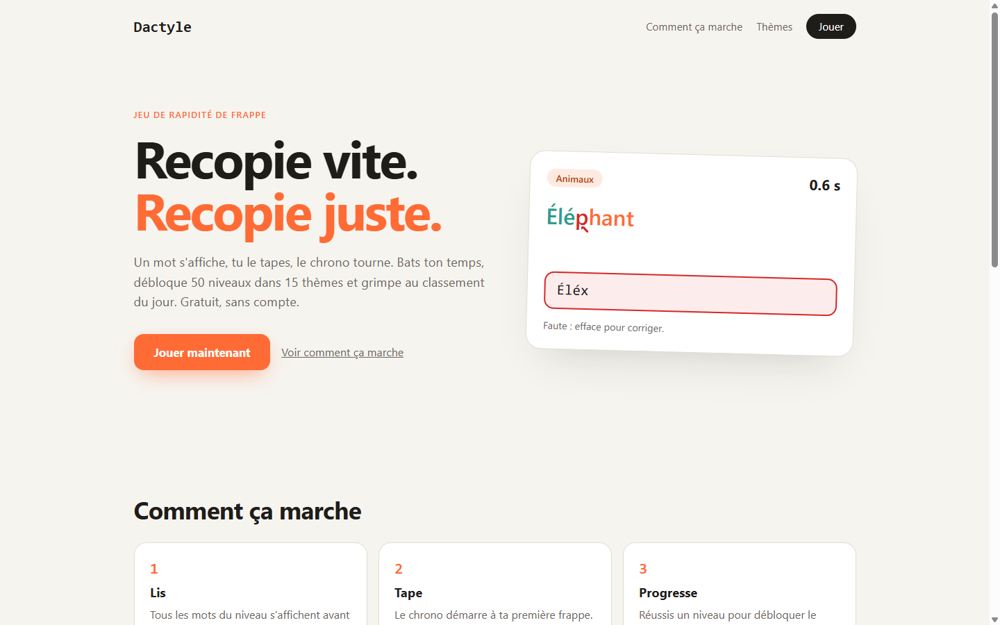
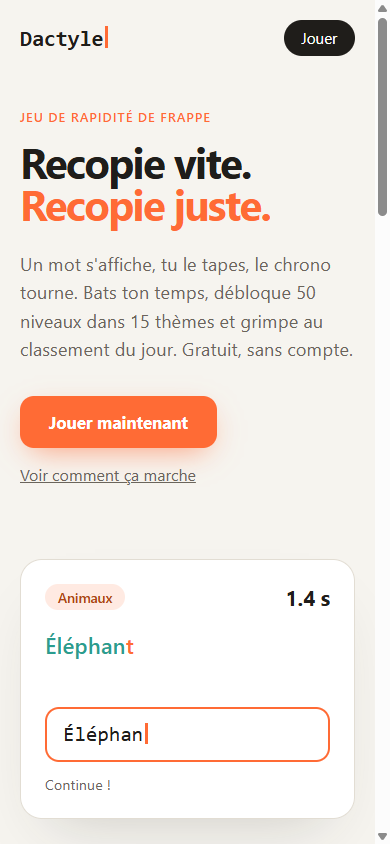

# Dactyle · Le jeu de rapidité de frappe

🌐 **[dactyle.projectp.fr](https://dactyle.projectp.fr/)** · Jour 24 du défi **[30 jours, 30 projets](https://projectp.fr/)** · [Dépôt du défi](https://github.com/PierreWZK/30DaysProjects)

Stack : TypeScript, Vite · ✅ Jouable.

[](https://dactyle.projectp.fr/)

<p align="center">
  
</p>

Un mot s'affiche, tu le recopies, le chrono tourne. 15 thèmes (animaux, cuisine, espace, code…) de 50 niveaux chacun, avec des mots de plus en plus longs et de plus en plus nombreux, tirés au hasard à chaque partie. Bats ton meilleur temps et débloque la suite.

📄 Les règles détaillées sont dans le [cahier des charges](CAHIER-DES-CHARGES.md).

## Fonctionnement

1. Choisis un **thème**, puis un **niveau**.
2. Tous les mots du niveau s'affichent : lis-les.
3. Tape le premier mot dans le champ de saisie. Le chrono démarre à la première frappe.
4. Chaque mot validé passe au suivant, dans l'ordre.
5. Tu réussis si tous les mots sont recopiés avant la fin du temps.

Une faute de frappe n'échoue pas le niveau : elle baisse ta **précision**. Un **mode strict** (accents et majuscules obligatoires) est disponible ; par défaut, `elephant` valide `Éléphant`.

À la fin d'un niveau : réussite ou échec, temps, mots recopiés, précision et vitesse (MPM). Les niveaux se débloquent un à un, par thème. Progression, meilleurs temps et statistiques sont sauvegardés dans le navigateur (`localStorage`), sans compte.

## Technologies

- **TypeScript** + **Vite** pour le jeu (HTML/CSS, sans framework)
- **Hono** (serveur Node) + **PostgreSQL** pour le classement global ; **PGlite** (Postgres en mémoire) en local et en test
- Tests : Vitest (moteur de jeu) et Playwright (parcours complet)
- Déploiement : image Docker (Node, site et API sur le même port) sur **Coolify**

## Installation

Prérequis : Node.js 22+ et npm.

```bash
npm install
```

## Configuration

| Variable | Rôle | Défaut |
|---|---|---|
| `PORT` | Port du serveur | `3000` |
| `DATABASE_URL` | Connexion PostgreSQL du classement | absente : base PGlite en mémoire (scores perdus à l'arrêt) |

## Lancement

```bash
npm run dev        # vitrine sur http://localhost:5173, jeu sur /jouer/ (classement indisponible)
npm run build      # jeu dans dist/, serveur dans server-dist/
npm start          # sert la vitrine, le jeu et l'API (http://localhost:3000)
npm test           # tests unitaires (Vitest)
npm run test:e2e   # tests E2E (Playwright, bureau + mobile)
```

> Tests E2E : ils tournent sur le build de production. Pour réutiliser un Chromium déjà installé, définir `PW_CHROMIUM_PATH`.

## Classement global

Pseudo libre, sans compte : un pseudo est réservé avec un jeton secret gardé dans le navigateur. Deux classements : le **niveau du jour** (résultat officiel, un par joueur et par jour) et le **meilleur temps par thème et par niveau**. Le serveur refuse les résultats invraisemblables (plus de 300 mots par minute, hors limite de temps) et limite le débit ; un joueur motivé peut tout de même tricher, il n'y a pas de comptes.

API : `POST /api/players`, `POST /api/scores/daily`, `POST /api/scores/level`, `GET /api/leaderboard/daily?date=`, `GET /api/leaderboard/level?theme=&level=`, `GET /api/health`.

## Vitrine et référencement

- `/` : page de présentation (`index.html`, `src/landing.ts`), avec démonstration de frappe animée, thèmes et activité du jour. Le jeu est sur `/jouer`.
- Balises de base sur chaque page : titre, description, `canonical`, Open Graph (`og:*`, image 1200 × 630 `public/og.png`), `twitter:card`, données structurées JSON-LD `WebApplication` rattachées à ProjectP, favicon.
- `public/robots.txt` (API en `Disallow`, lien vers le sitemap) et `public/sitemap.xml`.
- L'image d'aperçu est générée par `scripts/og/build-og.py` du dépôt du défi (capture : `docs/preview.png`).

## Informations pour le développement

- Un thème = un fichier dans `src/data/themes/`, à ajouter à `src/data/themes/index.ts`. Aucune modification du moteur.
- Les paramètres de progression (nombre de mots, longueur, temps) se règlent dans `src/data/levels.ts`.
- Le moteur (`src/game/`) ne touche pas au DOM : il est testable seul. Le serveur (`server/`) réutilise ses règles (niveau du jour, temps limites).
- Le chronomètre s'appuie sur `performance.now()`, pas sur le nombre d'affichages.
- Workflow Git : branche par défaut `master`, développement sur des branches de fonctionnalités, Pull Requests relues avant fusion.

## Mise en ligne

Image Docker (Nginx) prête : `Dockerfile` + `nginx.conf`. Déploiement prévu sur Coolify : **https://dactyle.projectp.fr**.

---

## Le défi 30 jours, 30 projets

Un projet complet par jour pendant 30 jours, chacun en ligne sur son propre sous-domaine.

- 🗂️ **Tous les projets** : [projectp.fr](https://projectp.fr/)
- 💻 **Le dépôt du défi** : [github.com/PierreWZK/30DaysProjects](https://github.com/PierreWZK/30DaysProjects)
- ⬅️ **Jour précédent** : [Anti-UX, musée à l'envers](https://anti-ux.projectp.fr/)
- ➡️ **Jour suivant** : [Carreau, défi CSS du jour](https://carreau.projectp.fr/)
